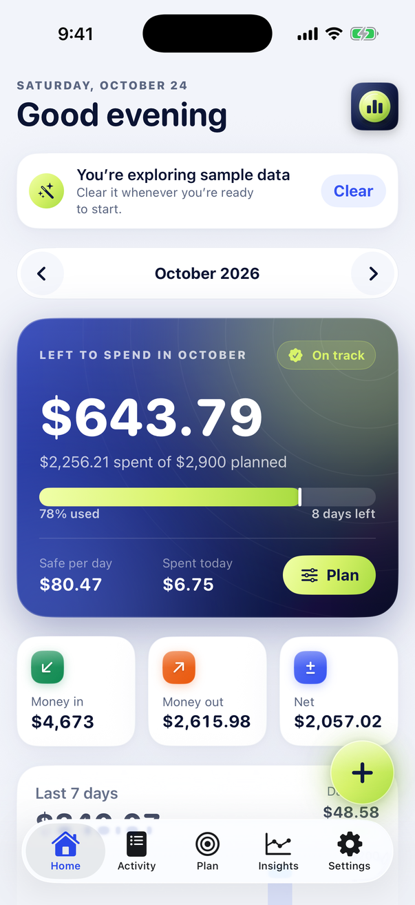
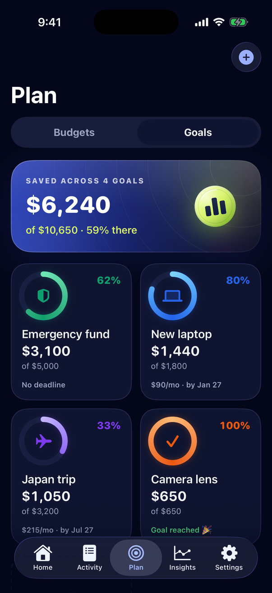
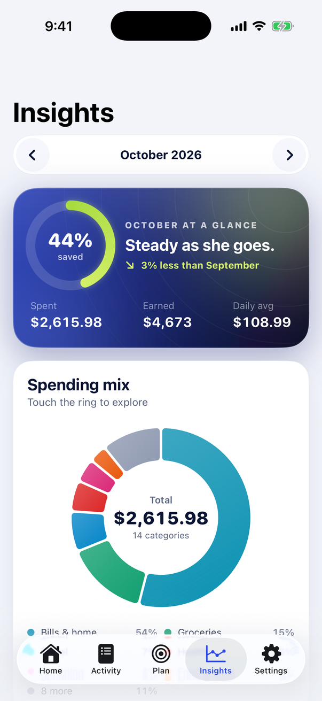

# Penny 3 — a beautiful money app for iPhone

Penny is a native SwiftUI expense tracker, budget planner and savings-goal app. Everything stays on your iPhone — no account, no tracking.

<p align="center">
  
  
  
</p>

## What's inside

- **Home** — greeting, a glowing "left to spend" hero with a pace marker and a *safe-to-spend-per-day* figure, money in/out/net, a 7-day spending rhythm chart (touch a bar), upcoming bills, savings goals and top categories.
- **Activity** — grouped by day with daily totals; search across this month or all time; quick filters (expenses, income, recurring, receipts) and categories; swipe to duplicate or delete with **Undo**; export CSV.
- **Plan › Budgets** — a limit per category with progress, pace markers and "≈ $X/day" guidance; smart suggestions (last month, 3-month average, trim 10%); remove a budget from any month on; see spending that isn't budgeted yet.
- **Plan › Goals** — savings goals with colors, icons and target dates; deposits and withdrawals with history; monthly amount needed and projected finish; confetti when you reach one 🎉.
- **Insights** — savings rate, interactive spending-mix donut, cumulative pace vs last month and your plan, six-month trend, weekly rhythm, top places, biggest expenses, income sources and fixed commitments.
- **Fast entry** — big amount pad, suggestions from your history (tap to fill description, category and amount), 19 colorful categories, Today/Yesterday chips, repeat weekly → yearly, notes and **receipt photos** (library or camera).
- **Recurring** — rent, salary, subscriptions recorded automatically; pause, resume, edit; monthly cost summary.
- **Siri & Shortcuts** — "Log an expense in Penny", "Log income in Penny", "How much have I spent in Penny", "New transaction in Penny".
- **Reminders** — optional daily check-in and a heads-up the day before each bill.
- **Personal touches** — light / dark / automatic theme, five home-screen icons (plus iOS 18 dark & tinted variants), 16 currencies, Face ID lock with privacy cover, haptics, onboarding tour.
- Accessible: Dynamic Type, VoiceOver labels on rows, charts and progress.

Amounts are stored as whole cents, so totals never drift. Penny 2 data upgrades automatically.

## Run it in Xcode

1. Unzip into a folder **outside** iCloud Drive, Desktop or Documents (for example `~/Developer/Penny`). iCloud adds hidden file attributes that make code signing fail.
2. Double-click **Penny.xcodeproj**.
3. Pick an iPhone simulator at the top of Xcode and press **⌘R**.

**Requirements:** Xcode 16 or newer (Xcode 26 recommended). Runs on iOS 17 and later, iPhone and iPad. No packages or CocoaPods.

## Install on your iPhone

1. In Xcode select the **Penny** project → **Penny** target → **Signing & Capabilities** → choose your **Team** (add your Apple ID under *Xcode → Settings → Accounts* if needed). A free Apple ID works.
2. If Xcode says the bundle identifier isn't available, change `com.reshardporter.penny` to something unique, e.g. `com.yourname.penny`.
3. Connect your iPhone with a cable, unlock it and tap **Trust**. On the iPhone turn on **Settings → Privacy & Security → Developer Mode** (it restarts).
4. Select your iPhone at the top of Xcode and press **⌘R**.
5. Free Apple ID only: on the iPhone open **Settings → General → VPN & Device Management**, tap your Apple ID and **Trust**. Free installs expire after 7 days — press ⌘R again to renew.

## Get a signed .ipa

An .ipa can only be signed with *your* Apple certificate, so it's built on your Mac (or in GitHub with your secrets):

### Option A — one command on your Mac (free or paid Apple ID)

After running the app on your iPhone once (above), in Terminal:

```bash
cd ~/Developer/Penny
scripts/make-signed-ipa.sh                     # auto-detects your team
# or: scripts/make-signed-ipa.sh YOURTEAMID com.yourname.penny --install
```

You get `build/Penny.ipa`, signed for your registered iPhone. `--install` installs it on the connected iPhone straight away. You can also drag the .ipa onto your iPhone in Finder or use Apple Configurator.

### Option B — Xcode menus (paid developer account)

*Product → Archive* → **Distribute App** → **Debugging** (or **Release Testing** for Ad Hoc) → **Export**.

### Option C — GitHub Actions (paid developer account)

Add the secrets listed at the top of `.github/workflows/signed-ipa.yml` (your .p12 certificate, its password, a provisioning profile and your Team ID), then run **Actions → Signed IPA → Run workflow**. Download `Penny-signed-ipa` from the run.

### Option D — Sideloadly / AltStore (free Apple ID, Windows or Mac)

Every push builds an unsigned IPA: download **Penny-unsigned.ipa** from the [latest-build release](../../releases/tag/latest-build) and open it in Sideloadly or AltStore — they sign it with your Apple ID as they install.

## Tests

Press **⌘U**. Swift Testing suites cover exact-cents parsing and formatting, recurring schedules (no month-end drift, biweekly and quarterly), budget carry-forward and removal, month summaries, goal math, insights (top places, weekday rhythm) and CSV formula neutralization.

## Project layout

```text
Penny.xcodeproj           Xcode project (folder-synced: new files are picked up automatically)
Penny/PennyApp.swift      App entry, tabs, onboarding, global add sheet, toasts, confetti, lock
Penny/Models/             Ledger types, SwiftData models, money, summaries, budgets, goals, insights, CSV
Penny/Support/            Theme, app state & store, Face ID lock, recurring engine, reminders,
                          Siri / Shortcuts intents, sample data
Penny/Views/              Home, Activity, Plan (budgets + goals), Insights, Settings, entry form,
                          recurring, receipts, onboarding, shared components
Penny/Assets.xcassets     App icons (default + 4 alternates, dark & tinted), coin and logo art
PennyTests/               Unit tests (Swift Testing)
scripts/                  make-signed-ipa.sh, simulator screenshots, icon renderer
.github/workflows/        Cloud build + tests + unsigned IPA; optional signed IPA
```

## Troubleshooting

- **"Command CodeSign failed"** — run `xattr -cr .` inside the project folder, then *Product → Clean Build Folder* (⇧⌘K) and run again. Make sure the folder isn't in iCloud Drive.
- **"Signing requires a development team"** — only for real devices; see *Install on your iPhone*. The simulator needs no team.
- **"Failed to register bundle identifier"** — change the bundle identifier to something unique.
- **"Could not launch Penny … untrusted developer"** — trust your certificate on the iPhone (step 5 above).
- **Project won't open / shows as unsupported** — update Xcode to version 16 or newer.
- **Face ID in the Simulator** — *Features → Face ID → Enrolled*, then *Matching Face* when Penny asks.
